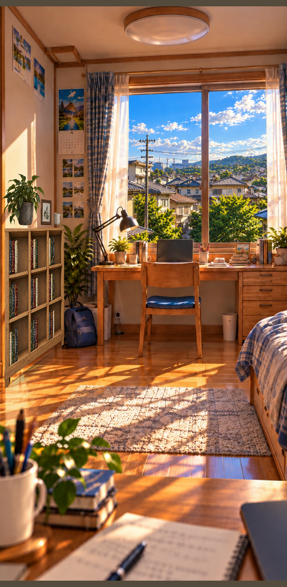
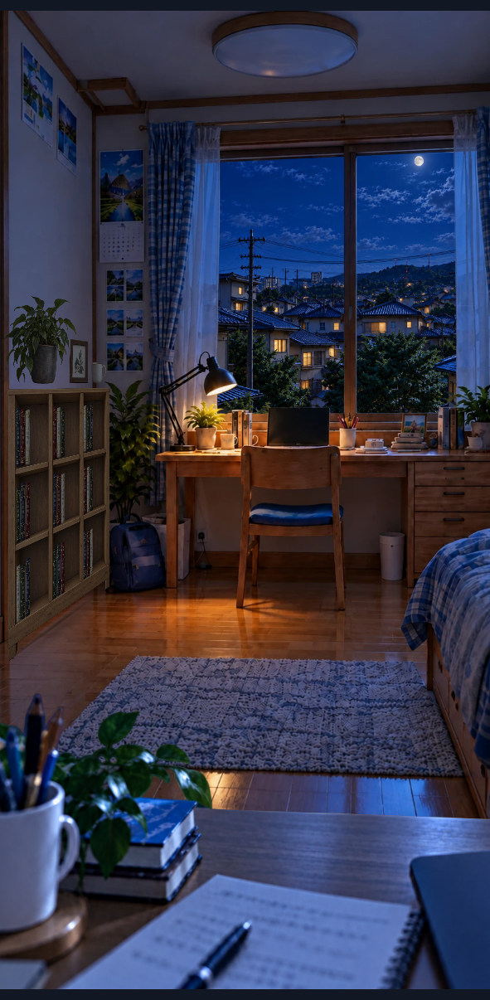
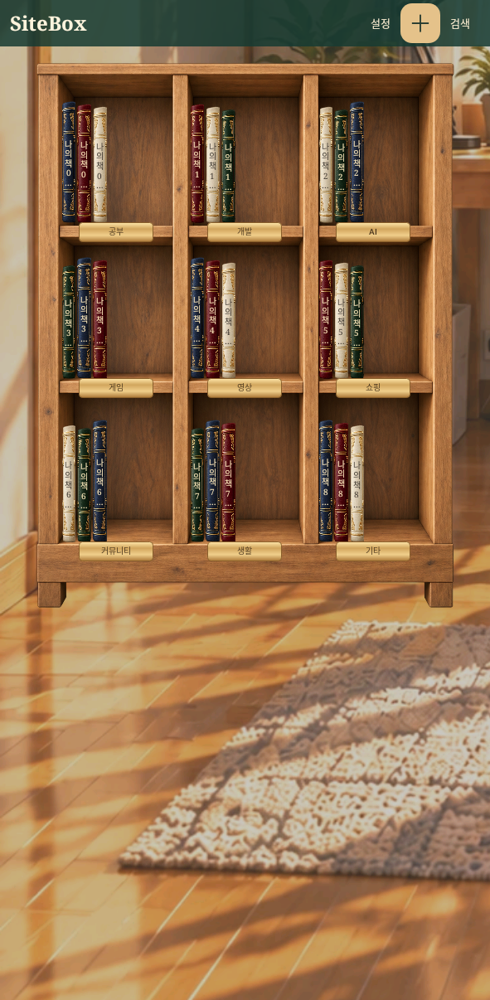

# SiteBox 3.1.0 · 학생 방

`SiteBox-3.1.0.apk`를 내려받아 설치하세요. 기존 3.0.x 검증판과 같은 패키지·서명키입니다.
설치한 앱의 키가 같은 경우 책 데이터를 유지하며 업데이트할 수 있습니다.

- 사진 기반 학생 방, 투명 창문·전경과 접지 그림자, 원근이 맞는 3×3 책장.
- 책장 터치로 접근, 두 손가락 오므리기·뒤로 가기로 방 복귀. 550ms 전환 도중 반전 가능.
- 실제 저장된 책과 같은 프레임을 확대·축소 화면에서 공유. 기존 편집·검색·페이지·계정·자동 동기화 유지.
- 지역 시간·날씨, 낮·밤과 조명 전환, 저사양 효과 줄이기.

검증 소스: `84fb330994cc39ad6403a81da8ba69e441d01f8c`. 앱 코드·이미지는 빌드 소스 `84fb330994cc39ad6403a81da8ba69e441d01f8c`와 동일합니다.
[Android 15 실제 앱 검사](https://github.com/shinminjun06/Sitebox-Android/actions/runs/39925249890) · 단위 테스트 53개 · debug/preview/release 빌드 · debug/release lint 오류 0 · 기존 서명 확인.
APK는 이 클라우드 환경에서 빌드·서명했습니다. Actions는 같은 소스의 빌드·기기 검사와 완성된 서명 APK의 설치 검사를 수행합니다.

`room-*.png`, `editor-day.png`, `approach.png`, `tall-room.png`, `wide-room.png`는 네이티브 렌더링 테스트 결과입니다.
테스트 책 데이터는 APK에 포함되지 않습니다. 기기 화면·검사 로그는 Actions의 QA 아티팩트에 있습니다.
실제 Google 로그인·Drive 전송과 실물 기기 60fps는 검증하지 않았습니다.
에셋 규격·좌표·레이어·한계는 동봉 문서를 확인하세요.

## 화면

[배포용 서명 APK 설치·실행 검증](https://github.com/shinminjun06/Sitebox-Android/actions/runs/39926760328) 통과. 직접 다운로드와 Actions 아티팩트를 각각 내려받아 원본과 동일함을 확인했습니다. `signed-release-*.png`는 배포 APK의 실제 Android 15 화면입니다.
