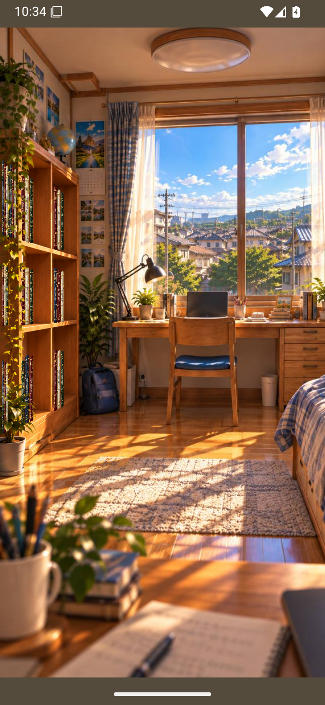
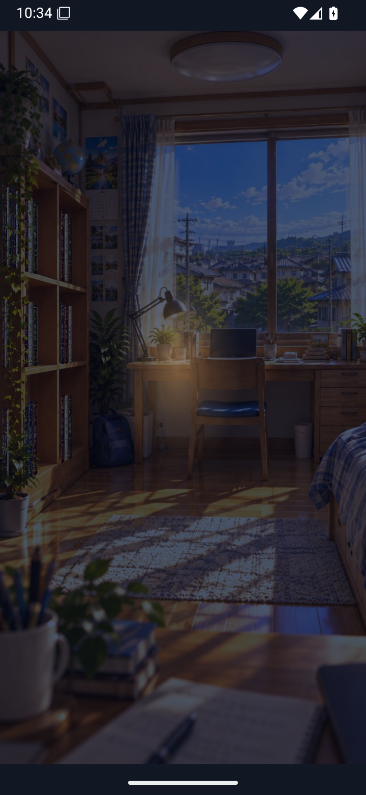
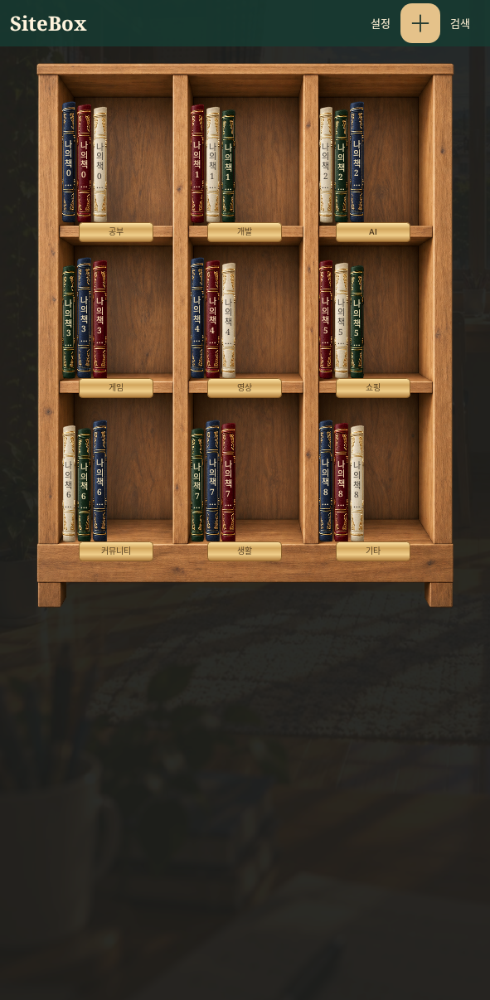
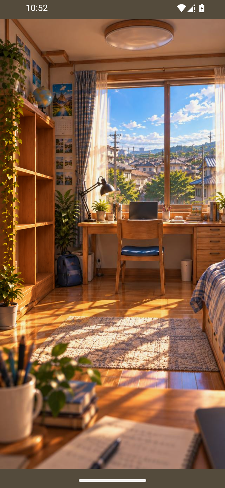

# SiteBox 3.1.1 · 원본 사진 방

`SiteBox-3.1.1.apk`를 내려받아 설치하세요. 이전 검증판과 같은 패키지와 서명키입니다.
목표 사진의 책상·벽·모서리·침대·창문을 그대로 사용하고 책장 영역에만 실제 저장된 책을 표시합니다.
사진 속 3×3 선반에 맞춘 책과 앞쪽 식물 가림을 사용하며 독립적인 입체 가구나 책상을 합성하지 않습니다.
터치 접근·핀치 축소·Back·550ms 반전 전환과 기존 책 관리·계정·자동 동기화를 유지합니다.

검증 소스: `efbcd0547a8c7e0fe41a379516abdb2f0164c6b7`. [Android 15 전체 검사](https://github.com/shinminjun06/Sitebox-Android/actions/runs/39941276513).
단위 테스트 53개 통과, debug/preview/release/AndroidTest 빌드 및 debug/release lint 오류 0.
APK는 클라우드 환경에서 R8 릴리스 빌드·서명하며, Actions는 같은 소스의 빌드·기기 검사와 배포 APK 설치 검사를 수행합니다.
밤은 동일 사진의 색감 보정입니다. 실제 Google 동의/실계정 Drive 전송과 실물 기기60fps는 검증하지 않았습니다.
구조·좌표·에셋·한계는 동봉 `REFERENCE_PHOTO_ROOM_KO.md`에 있습니다.
화면의 책은 검사 데이터이며 APK에는 포함되지 않습니다. 새 설치에는 실제 저장·복원된 책만 표시합니다.

[서명 APK 설치·실행 검사](https://github.com/shinminjun06/Sitebox-Android/actions/runs/39941931244) 통과. 공개 링크와 Actions 아티팩트를 다시 내려받아 동일 파일임을 확인했습니다.

