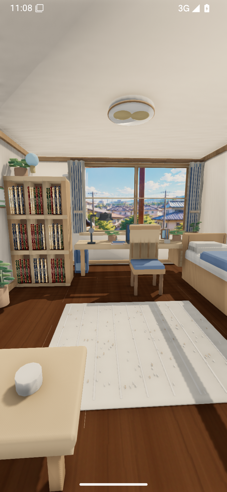
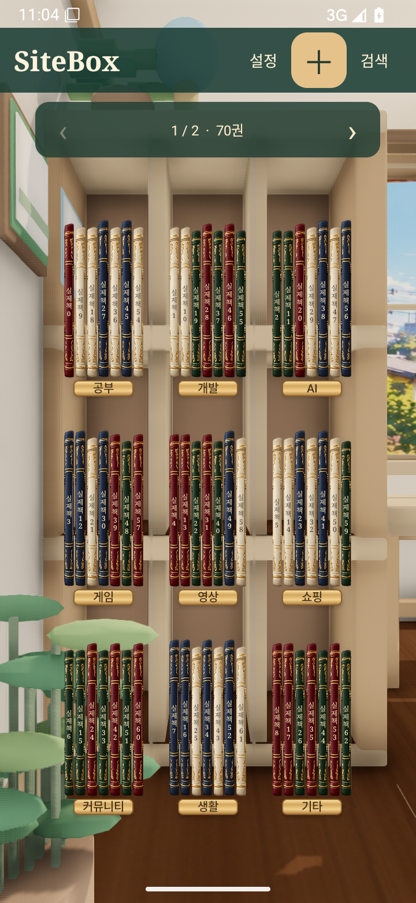
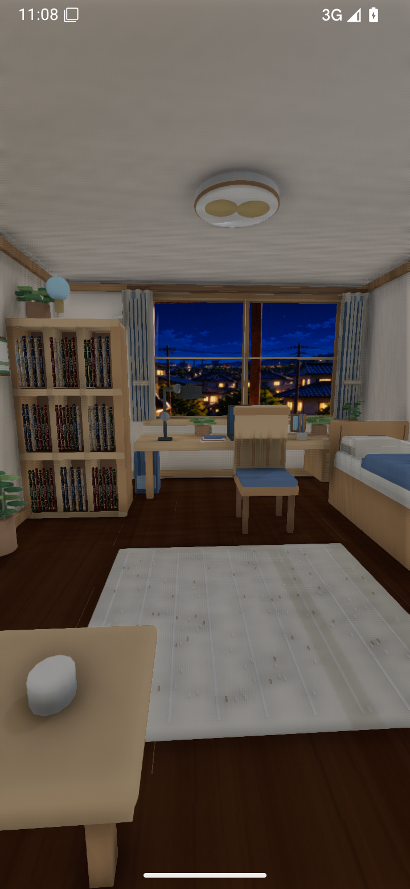
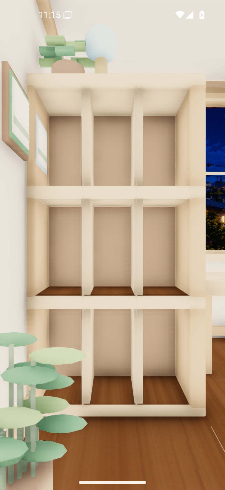

# SiteBox 3.2.0 · 실제 GLB 방

`SiteBox-3.2.0.apk`를 내려받아 설치하세요. 이전 검증판과 같은 패키지와 서명키로 업데이트할 수 있습니다.
사용자 제공 GLB 전체를 Filament로 렌더링하며 같은 책장에 접근해 실제 책을 관리합니다.
책장 터치 확대, 물리 핀치/Back 축소, 네이티브 책 추가·수정·삭제·드래그와 Google 자동 동기화를 유지합니다.
빈 공간 길게 누르기로 화면이 숨겨지는 동작은 제거했습니다. 창문은 실제 낮·밤·비·눈 이미지로 바뀝니다.

검증 소스 `cba6e0fd4712659fcf984ee4258f6bf26a52ecb8`, [Android 15 전체 검사](https://github.com/shinminjun06/Sitebox-Android/actions/runs/40088117137).
단위 테스트 66개, debug/preview/release/AndroidTest 빌드, debug/release lint 오류 0.
실제 Google 동의/실계정 Drive와 실물 기기60fps는 검증 범위 밖입니다.
책은 네이티브 View를 모델 선반에 투영하고 프레임/방은 실제 3D입니다. 세부 구조와 한계는 FULL_ROOM_3D.md에 있습니다.
화면의 책은 검사 데이터이며 APK에는 미리 넣지 않습니다.

[서명 APK 설치·실행 검사](https://github.com/shinminjun06/Sitebox-Android/actions/runs/40088952482) 통과. 공개 링크와 Actions 아티팩트를 다시 내려받아 동일 파일임을 확인했습니다.

