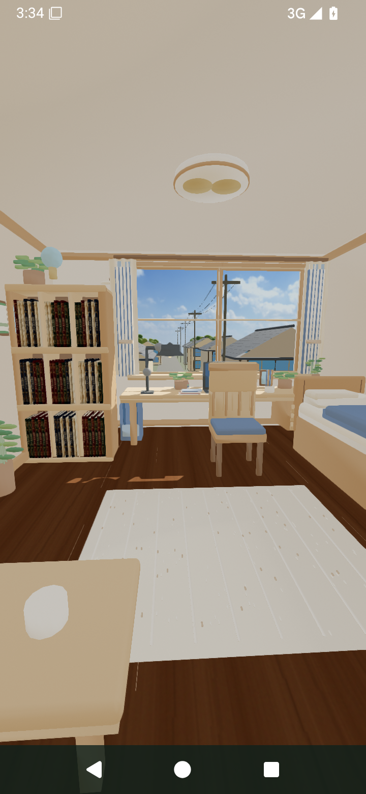
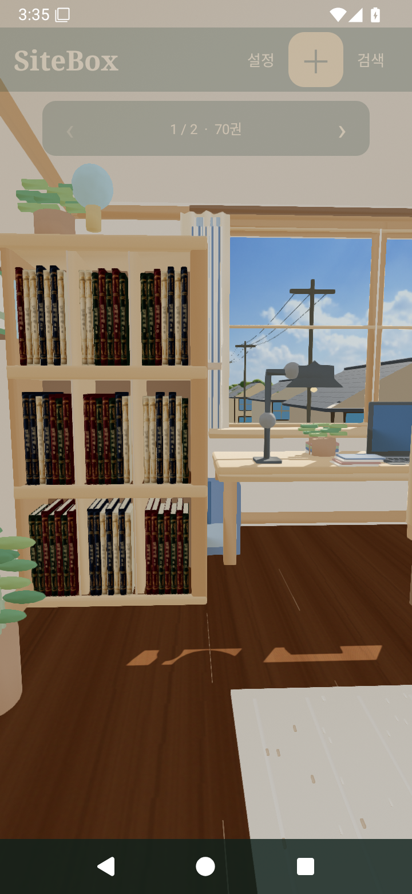
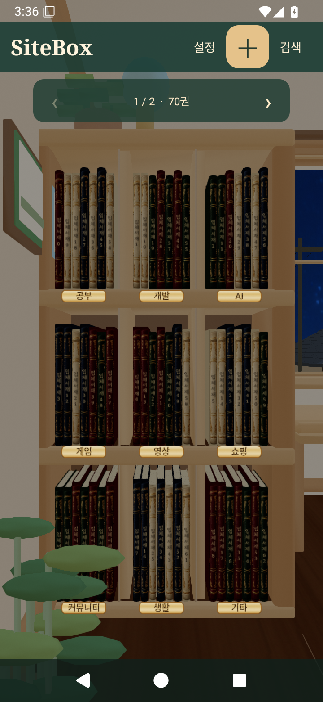

# SiteBox 3.3.0 · 실제 3D 책과 방향성 조명

`SiteBox-3.3.0.apk`를 내려받아 설치하세요. 이전 검증판과 같은 패키지/서명키로 업데이트할 수 있습니다.

- 실제 데이터의 책을 하드커버·종이 블록·곡면 책등이 있는 닫힌3D 메시로 렌더링합니다.
- 실제 창문 개구부를 통과하는 햇빛과 스탠드 스폿 조명이 가구·책에 그림자를 만듭니다.
- 깊이를 가진 주택·기와·전선·나무와 실제 촬영한 낮/흐림/별밤 하늘을 사용합니다.
- 기존3×3 책 관리·추가/삭제/드래그·메모·즐겨찾기·페이지·자동 동기화를 유지합니다.

검증 소스 `b9b47039df31f9fb848bec1eddbd118690eb4071`, [Android15 전체 검사](https://github.com/shinminjun06/Sitebox-Android/actions/runs/40158435966).
단위 테스트 80개, debug/preview/release/AndroidTest 빌드, debug/release lint 오류0.
실제 Google 동의/실계정 Drive 및 실물기기60fps는 검증 범위 밖입니다. 비·눈 입자 애니메이션은 없습니다.
아래 책은 검사 데이터이며 APK에 미리 넣지 않습니다. 에셋·좌표·조명·자원 관리·한계는 FULL_ROOM_3D.md와 THIRD_PARTY_SKY_ASSETS.md에 기록했습니다.

